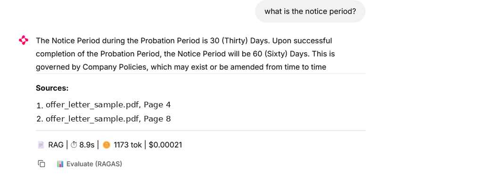
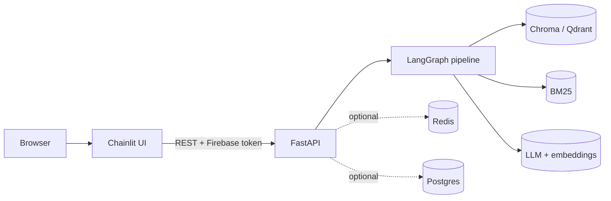
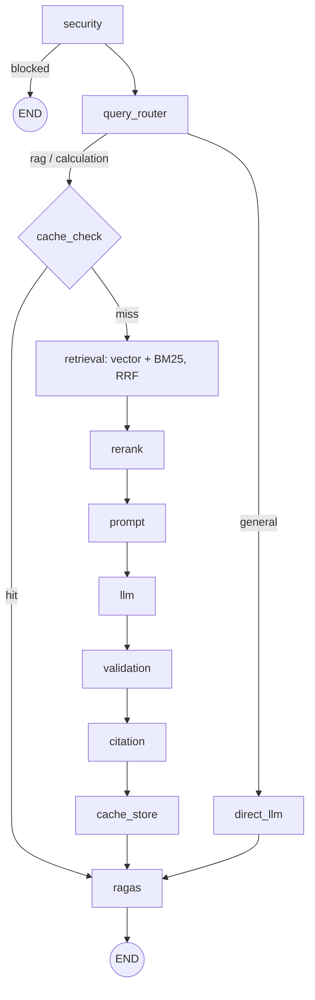

# Agentic RAG: a secure document assistant with LangGraph

Ask questions about your PDFs, Word files and slides, including scanned
ones, and get answers that cite the **file and page** they came from.

The project is built as a **LangGraph** state machine. At each step it
decides whether to search your documents, whether a cached answer can be
reused, and whether its own answer is grounded well enough to show you.



## Features

- **Hybrid retrieval:**
  - vector search (Chroma or Qdrant) and BM25 keyword search, merged with
    Reciprocal Rank Fusion;
  - a cross-encoder reranker.
- **Agentic pipeline:**
  - a query router that sends general questions straight to the LLM;
  - a semantic cache;
  - a two-tier groundedness check that labels answers not found in your
    documents;
  - query rephrasing when nothing relevant is found.
- **Any document:**
  - digital and scanned PDFs, DOCX and PPTX;
  - five OCR engines: EasyOCR, Tesseract, Google Document AI, AWS Textract
    and Azure Document Intelligence;
  - optional chart and image understanding.
- **Security:**
  - prompt-injection guard and canary token;
  - PII masked before indexing (configurable);
  - Firebase auth with roles (admin, engineer, user);
  - per-user document isolation.
- **Quality:**
  - RAGAS evaluation of any answer in one click;
  - golden-dataset batch evaluation with Excel export.
- **Operations:**
  - per-user quotas and cost tracking (FinOps);
  - LLM retries, rate limits and a circuit breaker;
  - conversation memory;
  - admin panel.
- **Portable:**
  - LLM providers: OpenAI, Azure OpenAI, Bedrock, Gemini, Anthropic;
  - runs locally, in Docker Compose, or on Google Cloud Run through GitHub
    Actions.

## Architecture





## Quick start

You need Python **3.11**, an OpenAI API key, and a free Firebase project.
The [setup chapter](docs/02-setup.md) walks through every step, including
Windows.

```bash
git clone https://github.com/palkarchinmay/agentic-rag-langgraph.git && cd agentic-rag-langgraph
cp .env.example .env                      # then fill it in (docs/02-setup.md)

# backend
python3.11 -m venv .venv-api && source .venv-api/bin/activate
pip install -r requirements.txt
python scripts/create_first_admin.py
uvicorn api.main:app --host 127.0.0.1 --port 8000

# UI (second terminal)
python3.11 -m venv .venv-ui && source .venv-ui/bin/activate
pip install -r requirements.chainlit.txt
chainlit run chainlit_app.py --port 8080
```

Open http://localhost:8080, sign in, attach a PDF with 📎, and ask a
question.

Or with Docker: `docker compose up --build` (see
[chapter 8](docs/08-deployment-cicd.md)).

## Training guide

This repository doubles as a hands-on course. Start at
**[docs/README.md](docs/README.md)**.

| # | Chapter |
|---|---|
| 1 | [Overview and architecture](docs/01-overview-and-architecture.md) |
| 2 | [Setup](docs/02-setup.md) |
| 3 | [First run](docs/03-first-run.md) |
| 4 | [Feature guide](docs/04-features.md) |
| 5 | [Code walkthrough](docs/05-code-walkthrough.md) |
| 6 | [Concepts](docs/06-concepts.md) |
| 7 | [Evaluating answer quality](docs/07-evaluation.md) |
| 8 | [Deployment and CI/CD](docs/08-deployment-cicd.md) |
| 9 | [Troubleshooting](docs/09-troubleshooting.md) |

## Project layout

```
api/        FastAPI app: auth, index, query, evaluate, admin routes
app/        ingestion, retrieval, LangGraph graph and nodes, security, cache, providers
ui/         Chainlit screens and callbacks
tests/      pytest suite (fully mocked, no API keys needed)
scripts/    first admin, role changes, GCP secrets, deploy
docs/       the training guide
```

## Tests

```bash
python -m pytest -q tests -p no:cacheprovider
```

The tests are fully mocked, so they make no paid API calls. The first run
downloads tiktoken's encoding files and needs internet access once.

## Known limitations

- **CI/CD:** the build and deploy jobs in `.github/workflows/deploy.yml` need
  your own Google Cloud project. Until you configure it
  ([chapter 8](docs/08-deployment-cicd.md)), only the test job will pass on
  forks.
- **BM25 on Cloud Run:** the keyword index is stored on local disk. On
  serverless platforms it is lost when an instance restarts, and hybrid
  search falls back to vector-only.
- **Rule-based router:** questions are classified with regular expressions.
  Unusual phrasing can take the slower RAG path. The groundedness check
  catches the result, so this costs time, not correctness.

## Tech stack

LangGraph · LangChain · FastAPI · Chainlit · ChromaDB / Qdrant · rank-bm25
· sentence-transformers · EasyOCR / Tesseract · RAGAS · Firebase Auth ·
Redis · PostgreSQL · Docker · Google Cloud Run · GitHub Actions

## License

[MIT](LICENSE)
