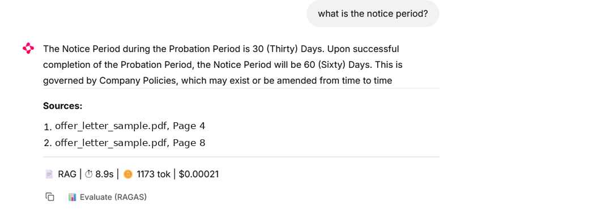
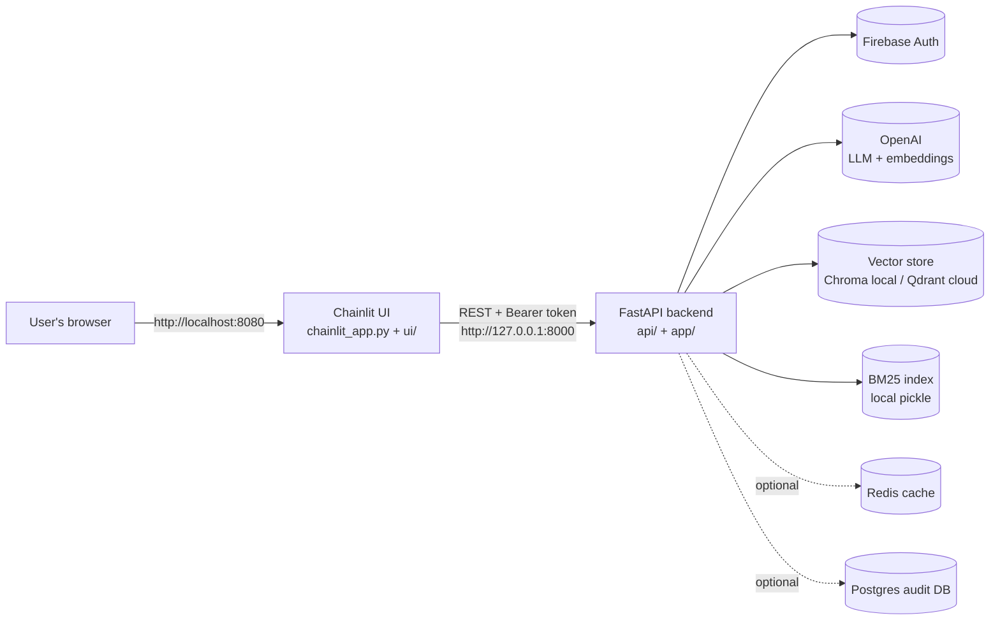
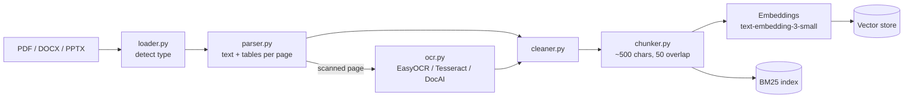
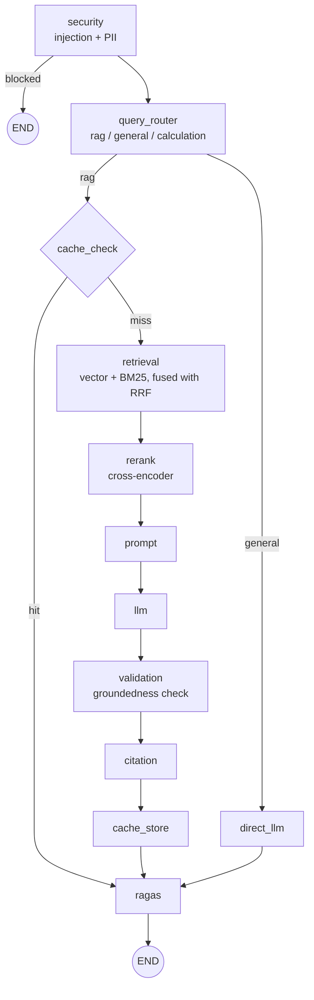

# Chapter 1: Overview and architecture

## 1.1 What you are building

A **document assistant** for financial and business documents. A user signs
in, uploads PDFs, Word files or slides (including scanned ones), and asks
questions in plain language. The assistant:

- answers **only from the uploaded documents** when the question is about them,
  and shows **which file and page** each answer came from;
- answers general-knowledge questions (for example "What is the capital of
  France?") directly, without searching documents;
- blocks prompt-injection attempts, and masks personal data such as Aadhaar
  or bank account numbers **before** documents are stored (you will see
  placeholders like `[AADHAAR]` and `[IBAN]` in retrieved chunks);
- checks that its own answer is grounded in the sources before returning it;
- caches answers to repeated questions so they cost nothing the second time;
- can score its own answers with **RAGAS** (faithfulness, answer relevancy).

## 1.2 Why "agentic" RAG?

Plain **RAG** (Retrieval-Augmented Generation) is a fixed pipeline: take the
question → find similar text chunks → paste them into a prompt → ask the LLM.

**Agentic RAG** adds decisions along the way. The system decides *whether*
to retrieve at all, *whether* a cached answer is good enough, and *whether*
the answer it produced is trustworthy enough to show. In this project those
decisions are nodes and conditional edges in a **LangGraph** state machine
(chapter 6 explains LangGraph in depth).

## 1.3 The big picture

The project is two processes that talk over HTTP, plus external services.

| Part | Folder | Role |
|---|---|---|
| **UI** | `chainlit_app.py`, `ui/` | Chat screen, file upload, settings panel, admin commands. Holds no ML code. |
| **API** | `api/` | FastAPI app: login, indexing, querying, admin, evaluation endpoints. |
| **Core** | `app/` | Everything the API uses: ingestion, retrieval, the LangGraph pipeline, security, caching, providers. |
| **Tests** | `tests/` | About 120 unit tests, all mocked (no API keys needed). |

**Why split UI and API?** The API carries heavy libraries (PyTorch,
transformers, EasyOCR). Keeping the UI separate means it installs in seconds,
can be deployed on its own, and could be replaced by any other front end
(the API has OpenAPI docs at `/docs`).

## 1.4 Two flows you need to know

### Flow A: indexing a document (`POST /api/v1/index`)

Each user gets their own collection, named `user_<email>`, so users never
see each other's documents.

### Flow B: answering a question (`POST /api/v1/query`)

This is the LangGraph pipeline in `app/graph/workflow.py`:

| Node | File | What it decides or does |
|---|---|---|
| `security` | `nodes/security_node.py` | Regex-based prompt-injection detection (can stop the run); flags PII in the question. |
| `query_router` | `nodes/query_router_node.py` | Classifies the question as `rag`, `general` or `calculation`. Only `general` skips retrieval; calculations still look up the numbers in your documents. |
| `cache_check` | `nodes/cache_node.py` | Has a *semantically similar* question been answered already (cosine ≥ 0.85)? |
| `retrieval` | `nodes/retrieval_node.py` | Fetches candidates from vector search **and** BM25 keyword search, merges them with Reciprocal Rank Fusion. |
| `rerank` | `nodes/rerank_node.py` | A cross-encoder re-scores each (question, chunk) pair and keeps the top *k*. |
| `prompt` | `nodes/prompt_node.py` | Builds the grounded prompt with numbered sources. |
| `llm` | `nodes/llm_node.py` | Calls the model through a resilience layer (retries, circuit breaker, cost limit). |
| `validation` | `nodes/validation_node.py` | Two-tier groundedness check. An ungrounded answer is replaced by a general-knowledge answer that is clearly labelled "not found in your uploaded document". |
| `citation` | `nodes/citation_node.py` | Attaches file + page sources. |
| `cache_store` | `nodes/cache_node.py` | Saves the answer for future similar questions. |
| `ragas` | `nodes/ragas_node.py` | Optional quality scoring, run on demand from the UI. |

## 1.5 Technology choices

| Need | Choice | Why |
|---|---|---|
| Orchestration | LangGraph | Explicit state machine: every branch is visible and testable. |
| API | FastAPI | Typed request/response models, automatic `/docs`, async. |
| UI | Chainlit | Chat UI with file upload, auth and settings out of the box. |
| Vector store | Chroma (local) / Qdrant (cloud) | Same interface; switch with `VECTOR_BACKEND`. |
| Keyword search | `rank-bm25` | Catches exact terms (IDs, amounts) that embeddings miss. |
| Reranker | `cross-encoder/ms-marco-MiniLM-L-6-v2` | Small (~90 MB), runs on CPU, big precision gain. |
| Auth | Firebase | Email/password + Google sign-in, roles via custom claims. |
| Evaluation | RAGAS | Standard RAG quality metrics. |

Almost every external dependency is swappable through `.env`: LLM provider
(OpenAI, Azure, Bedrock, Google, Anthropic), embeddings, vector store, cache,
storage, OCR engine. Chapter 2 starts with the simplest local setup.

## ✅ Checkpoint

You should be able to answer:

1. Which process does the OCR run in, the UI or the API? *(API)*
2. What happens to "What is the capital of France?" in the graph? *(router → `general` → `direct_llm`, no retrieval)*
3. Where is personal data masked? *(in `parser.py` at ingestion, via `mask_pii`, so it never reaches the vector store)*
4. Why are there two search indexes? *(vector for meaning, BM25 for exact words)*

Next: [Chapter 2: Setup](02-setup.md)
