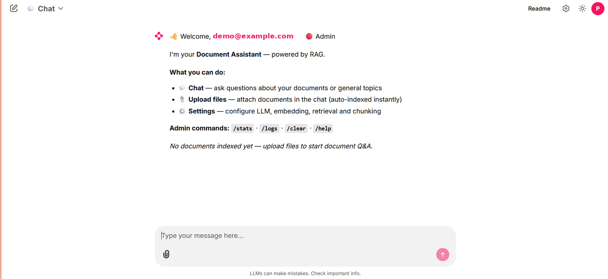
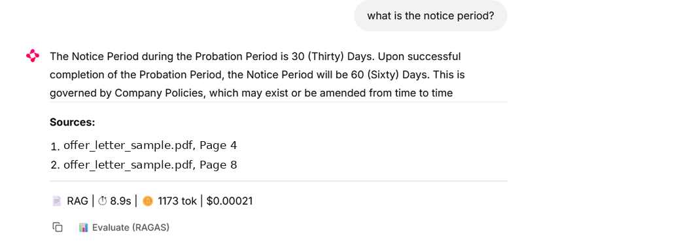
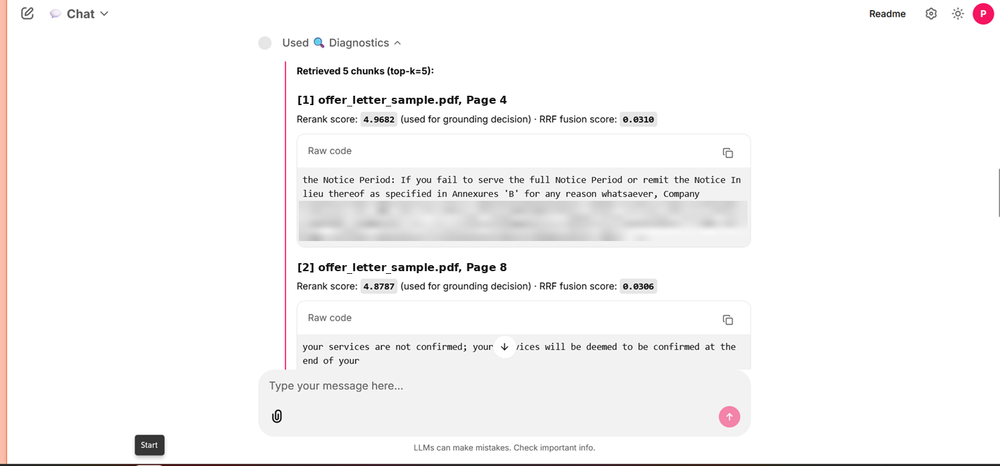
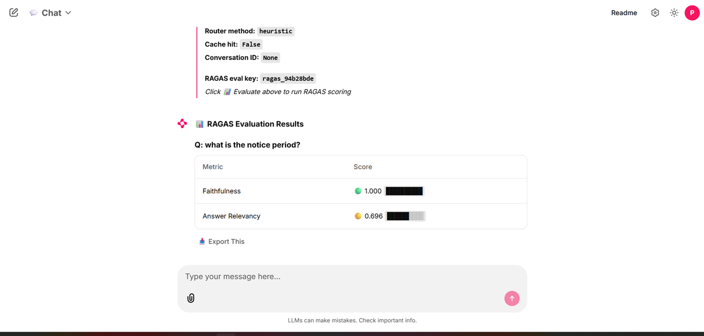

# Chapter 3: First run

You will start the API and the UI, sign in, index a PDF and ask questions,
then read the logs to see the LangGraph pipeline at work.

You need **two terminals** open in the project folder:

| Terminal | Environment | Runs |
|---|---|---|
| 1 | `.venv-api` | FastAPI backend on port 8000 |
| 2 | `.venv-ui` | Chainlit UI on port 8080 |

## 3.1 Start the API (terminal 1)

First make sure nothing old is still holding port 8000:

```powershell
# Windows
netstat -ano | findstr ":8000" | findstr LISTENING
# macOS / Linux
lsof -i :8000
```
No output is what you want. (See the warning in 3.6 if there is.)

```bash
uvicorn api.main:app --host 127.0.0.1 --port 8000
```

Expected log (abridged):
```
RAG API starting up...
API ready → http://localhost:8000/docs
Application startup complete.
Loading reranker model 'cross-encoder/ms-marco-MiniLM-L-6-v2'...
Reranker loaded
Reranker pre-warmed ✓ (first query will be fast)
```

The first start downloads the reranker model (~90 MB) from HuggingFace.

Check it from a browser:
- http://127.0.0.1:8000/health → `{"status":"ok", ...}`
- http://127.0.0.1:8000/docs → interactive Swagger page with ~24 endpoints

> 💡 **Should I use `--reload`?** Only while editing backend code, and then
> restrict what it watches: `--reload --reload-dir app --reload-dir api`.
> Plain `--reload` watches the whole folder, including the `.venv-*`
> folders, and restarts endlessly whenever pip touches a file.

## 3.2 Start the UI (terminal 2)

```bash
chainlit run chainlit_app.py --port 8080
```

Open http://localhost:8080 and sign in with the admin user from chapter 2.

In terminal 1 you should see:
```
Firebase Admin SDK initialized (project=<your-project>)
Login success: email='<you>' role='admin'
```



## 3.3 Index a document

1. Click the 📎 paperclip and choose a PDF.
2. The UI shows the ingestion settings (OCR engine, chunk size, overlap,
   vision) and "Sending to API for processing...".
3. Watch terminal 1. Within a second you should see
   `[xxxxxxxx] index request: files=['your.pdf']`.

What happens next depends on the PDF:

| PDF type | What you'll see | Time |
|---|---|---|
| **Digital** (you can select text) | `native` text extraction | seconds |
| **Scanned** (images of pages) | `📄 Page N: scanned → easyocr` per page | ~30 s per page on CPU with EasyOCR |

A successful run ends with:
```
chunked into 75 chunks
Creating embeddings: provider=openai model=text-embedding-3-small
Upserted 67 chunks into 'user_<you>'
BM25 upserted 67 chunks, total=67
indexing complete in 219.2s — 75 chunks, 75 vectors
```

Notice "75 chunks" but "67 upserted": a **quality filter** dropped 8 chunks
that were too short or looked like binary garbage
(`app/retrieval/vector_store.py → is_quality_chunk`).

> 💡 For your first run use a **digital** PDF, such as a public company's
> annual report. You'll get results in seconds instead of minutes.

## 3.4 Ask a question about the document

Ask something whose answer is in the PDF. The screenshots below use a
scanned employment offer letter (file name and personal details redacted):

> **what is the notice period?**



The answer covers both cases in the letter (30 days during probation, 60
days after) and cites the file and page of every source. The footer reads:
route **RAG**, **8.9 s** end to end, **1,173 tokens**, **$0.00021**.

Admins and engineers can expand **Used 🔍 Diagnostics** to see the chunks
the answer was built from:



What to notice:

- **Rerank score** (4.97 and 4.88): the cross-encoder's relevance score.
  Above 2.0 counts as high confidence, so the groundedness check accepts the
  answer without the second, embedding-based test (chapter 5.6).
- **RRF fusion score** (≈ 0.031): the score from merging vector and BM25
  results. It is tiny by design (chapter 6, B6).
- **OCR noise**: "whatsaever" instead of "whatsoever". On scanned pages, the
  text the system searches is only as good as the OCR (the blurred part of
  the chunk held a company address, garbled in the same way).
- **PII masking**: in your own chunks you may see tags like `[AADHAAR]` or
  `[IBAN]` where personal data was masked at ingestion, before it was ever
  embedded (chapter 4.13).

## 3.5 Evaluate the answer with RAGAS

Click **📊 Evaluate (RAGAS)** under the answer. It takes 15 to 30 seconds.



| Metric | Score | Meaning |
|---|---|---|
| Faithfulness | 1.000 | Share of the answer's claims that the retrieved chunks support. Every claim here was found in the sources. |
| Answer relevancy | 0.696 | How directly the answer addresses the question. Lower here because the answer adds a sentence about company policies that the question didn't ask for. |

Scores vary from run to run and depend heavily on the chunks. When
we first indexed this letter with an older OCR setup, the same question
scored only **0.40** faithfulness. The answer was correct, but the noisy
chunks didn't let the judge verify it. That's the real lesson: **RAG
quality is capped by ingestion quality.** Re-index a scanned file with a
better OCR engine (Tesseract or Google Document AI) and compare. Chapter 7
explains how RAGAS computes these numbers.

## 3.6 Ask a general question

> **What is the capital of France?**

The router classifies it as `general`, so the graph skips retrieval and goes
straight to `direct_llm` (no sources shown). Compare the timing with the
RAG answer.

## 3.7 Useful chat commands (admin)

| Command | Does |
|---|---|
| `/stats` | usage, tokens, cost |
| `/logs` | recent API log lines |
| `/clear` | **deletes your indexed documents** (vector + BM25) and resets the chat |
| `/help` | list commands |

> ⚠️ Commands need the slash. Typing `clear` without it sends a normal
> question.

> ⚠️ Uploading the same file twice **adds duplicate chunks**
> (`BM25 ... total=134`). Run `/clear` before re-indexing.

## 3.8 If something hangs or fails

| Symptom | Cause | Fix |
|---|---|---|
| UI stuck on "Sending to API..." and the API logs nothing | UI can't connect: an orphaned API process holds port 8000, or `RAG_API_URL` uses `localhost` on Windows | Check `netstat` (3.1), kill leftover `python.exe` uvicorn processes, use `127.0.0.1` |
| "Session expired, please log in again" after about an hour | Firebase ID tokens last 1 hour | Log out (avatar → Logout) and back in. A page refresh is not enough. |
| UI says "timed out", but the API log says `indexing complete` | Scanned PDF took longer than the UI's wait limit | Set `API_TIMEOUT_SECONDS=900` and restart Chainlit |
| Login returns 500, "Token used too early" | PC clock is off by more than 60 s | Sync the clock (chapter 2.8) |

More in [chapter 9, Troubleshooting](09-troubleshooting.md).

## ✅ Checkpoint

- [ ] `/health` and `/docs` work
- [ ] You signed in and the API logged `Login success`
- [ ] A PDF indexed and the API logged `indexing complete`
- [ ] A document question returned an answer **with page sources**
- [ ] A general question was answered without sources
- [ ] You ran a RAGAS evaluation

Next: [Chapter 4: Feature guide](04-features.md)
