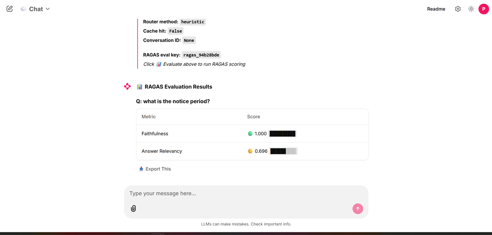
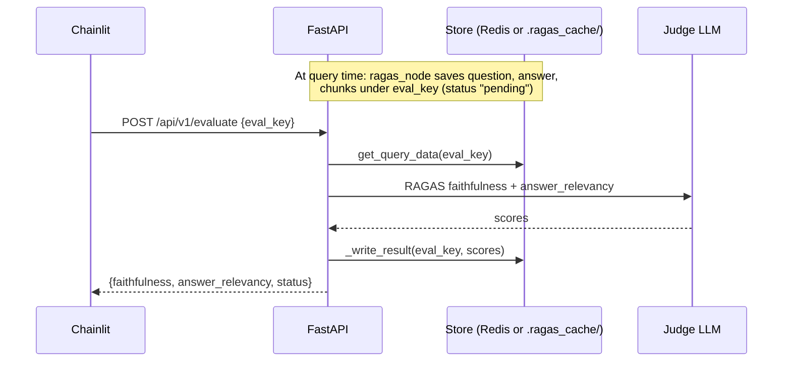

# Chapter 7: Evaluating answer quality

A RAG system can answer fluently and still be wrong. This chapter shows how
the project **measures** answer quality, in two ways:

| | Evaluation in chat | Golden-dataset evaluation |
|---|---|---|
| What | Score **one** answer you just got | Score a **fixed list** of questions in one run |
| How | Click **📊 Evaluate (RAGAS)** under an answer | Upload a CSV, type `/golden` |
| Needs a known correct answer? | No | Optional (`reference_answer` column), and it unlocks 2 more metrics |
| Use it to | Check a suspicious answer; learn the metrics | Compare settings (OCR engine, chunk size, model) before and after a change |
| Who can use it | admin, engineer | the `/golden` command works for every role |

Both use **RAGAS**, an open-source library that scores RAG answers using an
LLM as a judge.

## 7.1 The four metrics

RAGAS needs up to four inputs: the **question**, the **answer**, the
**contexts** (the chunks the answer was built from) and, optionally, a
**reference** (the correct answer, written by you).

| Metric | Needs a reference? | Question it answers | How RAGAS computes it |
|---|---|---|---|
| **Faithfulness** | no | Is every claim in the answer supported by the retrieved chunks? | The judge LLM splits the answer into short claims and checks each one against the contexts. Score = supported claims ÷ all claims. |
| **Answer relevancy** | no | Does the answer address the question that was asked? | The judge writes a few questions that the answer would answer. Each is embedded and compared with the real question by cosine similarity. Score = the average. Evasive or off-topic answers score low. |
| **Context recall** | yes | Did retrieval find everything needed? | The reference is split into statements; score = share of statements that can be found in the contexts. Low recall means a **retrieval** problem, not an LLM problem. |
| **Answer correctness** | yes | Is the answer actually right? | It compares the answer's claims with the reference's (true positives, false positives, false negatives → F1), blended with semantic similarity. |

All scores run from 0 to 1. The UI colours them: 🟢 ≥ 0.8, 🟡 ≥ 0.6,
🔴 below.

**Reading them together** is where the value is:

| Pattern | Likely cause | What to try |
|---|---|---|
| Faithfulness low, correctness high | The answer is right but the chunks are noisy (OCR), so the judge can't verify it | Better OCR engine (chapter 4.4) |
| Context recall low | The right chunk wasn't retrieved | Raise `top_k`, try `hybrid` mode, smaller chunks, different embedding model |
| Recall high, correctness low | The chunk was there but the LLM misread or ignored it | Stronger model, prompt changes |
| Relevancy low | The answer drifts or hedges | Check the "not found" fallback; question may be ambiguous |
| All low on one question only | The fact may be masked (PII) or absent | Look at the chunks in Diagnostics |

> 💡 The judge is itself an LLM, so scores vary a little between runs
> (±0.05 is normal). Compare averages over several questions, not single
> numbers.

## 7.2 Evaluation in chat

### Try it

1. Sign in as admin or engineer, index a document, and ask a question about
   it.
2. Under the answer, click **📊 Evaluate (RAGAS)**. A "Running RAGAS
   evaluation…" message appears. It takes 15 to 30 seconds.
3. A table with Faithfulness and Answer Relevancy appears, with
   **📥 Export This** (and **📊 Export All** once you have more than one).



### When the button does not appear

The pipeline only prepares an evaluation for a fresh, document-based answer.
`ragas_node` skips it, and so no button is shown, when:

| Reason (in `metadata.ragas.reason`) | Meaning |
|---|---|
| `cache_hit` | The answer came from the semantic cache; there's nothing new to score |
| `not_rag` | A general question, **or** a document question whose answer failed validation and fell back to general knowledge |
| `missing_data` | No chunks were retrieved |
| (role) | You are signed in as `user`; the button is for admin and engineer |

### What happens behind the click



Why not just score every answer automatically? Two reasons:

- **Cost and latency.** RAGAS makes several LLM calls per answer. Scoring
  every answer would roughly double the cost of every question.
- **Cloud Run.** On serverless platforms, a background thread is stopped as
  soon as the HTTP response is sent, so a "score it in the background" design
  never finished. Saving the data and scoring on demand works everywhere.

The data is stored for 2 hours (`RAGAS_RESULT_TTL`, in seconds). After that,
the button returns an error and you need to ask the question again.

### Where evaluations are kept

- **With Redis** (`CACHE_BACKEND=redis`): evaluations are saved per user
  and survive switching between 💬 Chat and 📊 Diagnostics.
- **Without Redis (local mode)**: they are kept for the browser session.
  Switching profiles starts a new session, so the list is lost.

The **📊 Diagnostics** profile shows a summary table of all stored
evaluations, with **🎯 Golden Dataset Test**, **🗑️ Clear All
Evaluations** and export buttons. Exports are Excel files.

**Code:** `ui/query_handler.py` (button), `ui/evaluation_actions.py`
(callback, display, export), `api/routers/evaluate.py`,
`app/graph/nodes/ragas_node.py`, `app/evaluation/ragas_evaluator.py`.

## 7.3 Golden-dataset evaluation

A **golden dataset** is a set of questions whose correct answers you know,
kept under version control and re-run after every change. It turns "the
answers feel better" into "average answer correctness went from 0.71 to
0.84".

### Step 1: write the CSV

```csv
question,reference_answer
What is the notice period after confirmation?,60 days
What is the joining date?,21 January 2026
What is the total annual CTC?,"Rs. 12,00,000 per annum"
```

Rules (from `run_golden_evaluation_interactive` in `ui/query_handler.py`):

- A `question` column is required. Column names are case-insensitive.
- `reference_answer` is optional. `reference`, `answer` and
  `expected_answer` are accepted as alternative names.
- Wrap values containing commas in double quotes, as above.
- UTF-8, with or without BOM; Windows line endings are fine (Excel's "CSV
  UTF-8" export works).
- Rows with an empty question are skipped.

A starter file is in
[`examples/golden_sample.csv`](examples/golden_sample.csv). Its answers are
placeholders: **replace them with facts from your own document**.

**What makes a good golden set**

- 15 to 50 questions. Fewer is noisy; more is slow and costs more.
- A mix of question types:
  - simple facts ("joining date");
  - numbers and amounts;
  - facts from tables;
  - facts that need two chunks;
  - one or two questions whose answer is **not** in the document, to check
    that the system says so instead of inventing an answer.
- Short reference answers containing just the fact. Long references make
  correctness scores noisy.
- Questions phrased the way users actually ask, not copied from the
  document's wording. Copied wording makes BM25 look better than it is.

### Step 2: run it

1. Make sure the document is indexed (`/clear` first if you've changed
   ingestion settings, then upload it again).
2. In 💬 Chat, attach the CSV with 📎. The UI recognises `.csv` files and
   replies "This looks like a golden dataset file". It is **not** indexed.
3. Type `/golden`.

For each row, the UI:

1. sends the question to `/api/v1/query` with `skip_cache=True` (a cached
   answer would hide the effect of your change) and no chat history (each
   question stands alone);
2. sends the answer and the reference to `/api/v1/evaluate`, which adds
   context recall and answer correctness because a reference is present;
3. updates a live progress line: ⬜ waiting, 🔄 running, ✅ scored,
   ⚠️ answered but not scored, ❌ failed.

When it finishes, you get a summary table in the chat and
**golden_eval_results.xlsx** with every metric for every question.

### Step 3: compare runs

Keep each Excel file with a note of what changed. A simple comparison:

| Run | Change | Faithfulness | Relevancy | Recall | Correctness |
|---|---|---|---|---|---|
| A | baseline: EasyOCR, chunk 500 | 0.52 | 0.78 | 0.61 | 0.66 |
| B | Tesseract | 0.71 | 0.80 | 0.74 | 0.79 |
| C | Tesseract, chunk 800 | 0.69 | 0.81 | 0.82 | 0.81 |

*(Illustrative numbers. Measure your own.)*

Change **one thing per run**, otherwise you can't tell which change helped.

### Cost and time

Each row makes one query (several LLM calls when the "not found" recovery
runs) plus a RAGAS evaluation (about 4 to 8 judge calls with a reference).
With `gpt-4o-mini`, a 20-question run usually costs a few US cents and takes
5 to 10 minutes. Watch **/stats** or 💰 Usage & FinOps to see the real
numbers.

## 7.4 Running RAGAS from your own code

`app/evaluation/ragas_evaluator.py` can be called directly, which is handy
in a notebook or a CI job:

```python
from app.evaluation.ragas_evaluator import evaluate_response

scores = evaluate_response(
    question="What is the notice period?",
    answer="The notice period is 60 days after confirmation.",
    retrieved_docs=[{"content": "…either party may terminate with 60 days' notice…"}],
    reference="60 days",
)
print(scores)   # {'faithfulness': 1.0, 'answer_relevancy': 0.93, 'context_recall': 1.0, …}
```

Implementation notes worth knowing:

- Each chunk is cut to 1,000 characters before scoring (800 in
  `evaluate_batch`), so very long chunks are judged on their start only.
- With `llm_provider="openai"`, RAGAS uses the same model as the app as the
  judge, and `text-embedding-3-small` for relevancy. Using the answering
  model as its own judge is cheap but lenient; for serious comparisons,
  consider a stronger judge model.
- Errors never raise. The function returns `{"error": "..."}`, and the UI
  shows it.

## 7.5 Exercises

1. Write a 10-question golden set for one document, with two questions whose
   answer is not in it. Run `/golden`.
2. Re-index with a different OCR engine or chunk size and run it again.
   Which metric moved the most, and why?
3. Find a question where faithfulness is low but correctness is high. Open
   Diagnostics and explain the gap by reading the chunks.

## ✅ Checkpoint

- [ ] You ran 📊 Evaluate on one answer and can explain both scores
- [ ] You know the four situations where the Evaluate button is not shown
- [ ] You ran `/golden` on your own CSV and downloaded the Excel results
- [ ] You can say which metric points to a retrieval problem *(context
      recall)* and which to a grounding problem *(faithfulness)*

Next: [Chapter 8: Deployment and CI/CD](08-deployment-cicd.md)
