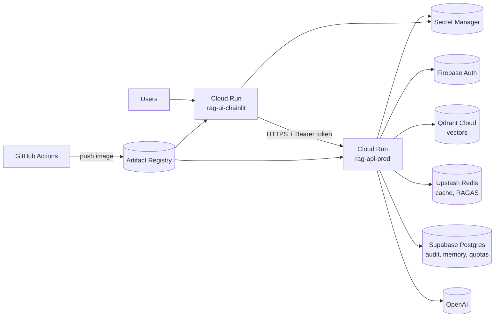
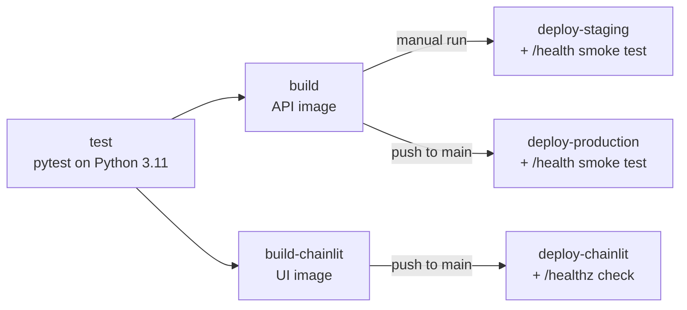

# Chapter 8: Deployment and CI/CD

So far everything has run on your own computer. This chapter packages the
two services as containers, runs them with Docker Compose, and then deploys
them to **Google Cloud Run** with a **GitHub Actions** pipeline that tests,
builds and deploys on every push to `main`.

| Stage | You get | Section |
|---|---|---|
| Local, two venvs | what you used in chapters 2 to 7 | – |
| Docker Compose | both services in containers on your machine, plus optional Postgres and Redis | 8.2 |
| Cloud Run, by hand | a public URL, deployed from your terminal | 8.5 |
| Cloud Run, CI/CD | automatic test → build → deploy on `git push` | 8.6 |

## 8.1 The two images

### `Dockerfile.api`: the backend

```dockerfile
FROM python:3.11-slim AS builder        # stage 1: compile and install
RUN apt-get install gcc g++ … libgl1    #   build tools + OpenCV libs
RUN pip install -r requirements.txt     #   the heavy ML stack

FROM python:3.11-slim AS runtime        # stage 2: what actually ships
COPY --from=builder /usr/local/lib/python3.11/site-packages …
COPY app/ ./app/
COPY api/ ./api/
RUN useradd -m -u 1000 raguser          # never run as root
USER raguser
HEALTHCHECK … curl -f http://localhost:8000/health
CMD ["uvicorn", "api.main:app", "--host", "0.0.0.0", "--port", "8000", "--workers", "2"]
```

Four ideas to take from it:

- **Multi-stage build.** Compilers are needed to *install* some packages, not
  to *run* them. Stage 1 has them; stage 2 copies only the installed
  packages. The shipped image is smaller and has fewer tools an attacker
  could use.
- **Only code is copied.** `.env`, `chroma_db/`, logs and venvs are not in
  the image. Configuration comes from environment variables at run time.
- **Non-root user.** If the app were compromised, the attacker would not be
  root inside the container.
- **Health check.** Docker and cloud load balancers call `/health` to decide
  whether the container is alive.

### `Dockerfile.chainlit`: the UI

It's a single stage, because the UI has no heavy dependencies. It installs
`requirements.chainlit.txt`, copies `app/`, `ui/`, `chainlit_app.py`,
`.chainlit/` and `public/`, and runs:

```
chainlit run chainlit_app.py --host 0.0.0.0 --port ${PORT} --headless
```

Cloud Run tells a container which port to listen on through `PORT`, which is
why the port is a variable.

### The `.dockerignore`

Without a `.dockerignore`, `docker build` uploads your
whole folder as the build context, including both venvs (several GB) and
`.env`. The repository's `.dockerignore` excludes them:

```
.venv*/
.env
.env.*
chroma_db/
logs/
.cache/
.ragas_cache/
.files/
__pycache__/
*.pyc
.git/
docs/
postman/
```

## 8.2 Run everything with Docker Compose

`docker-compose.yml` defines four services:

| Service | Image | Port | Started by default? |
|---|---|---|---|
| `api` | built from `Dockerfile.api` | 8000 | yes |
| `chainlit` | built from `Dockerfile.chainlit` | 8080 | yes (waits for `api` to be healthy) |
| `db` | `postgres:16-alpine` | 5432 | only with `--profile with-db` |
| `redis` | `redis:7-alpine` | 6379 | only with `--profile with-redis` |

**Steps**

1. Install Docker Desktop and start it.
2. Build and start:
   ```bash
   docker compose up --build
   ```
   The first build takes 10 to 20 minutes (the same ML stack as chapter 2).
3. Open http://localhost:8080 and sign in.

Inside Compose, the UI reaches the API at `http://api:8000`: `api` is the
service name, resolved by Docker's internal DNS. The compose file sets
`RAG_API_URL` for you, overriding the `127.0.0.1` value from `.env`.

**Volumes** keep data when containers are recreated:

| Volume | Holds | Lose it and… |
|---|---|---|
| `chroma_data` | vectors and BM25 index | you must re-index everything. **Back this up.** |
| `cache_data` | semantic cache | answers are slower until re-cached |
| `ragas_data` | pending RAGAS evaluations | you can't evaluate old answers |
| `log_data` | logs (shared by both services) | `/logs` starts empty |

**With Postgres and Redis**

```bash
docker compose --profile with-db --profile with-redis up --build
```

Then add to `.env`:

```ini
AUDIT_DB_URL=postgresql://raguser:ragpassword@db:5432/ragdb
CACHE_BACKEND=redis
REDIS_URL=redis://:redispassword@redis:6379/0
```

This unlocks conversation memory, quotas, FinOps and persistent evaluations
(chapter 4.17). Change the default passwords (`POSTGRES_PASSWORD`,
`REDIS_PASSWORD`) in `.env` before exposing anything beyond your machine.

**Useful commands**

```bash
docker compose ps                 # status and health
docker compose logs -f api        # follow the API log
docker compose restart api        # after changing .env
docker compose down               # stop (volumes are kept)
docker compose down -v            # stop AND delete volumes (all indexed data!)
```

## 8.3 Production architecture on Google Cloud



### Why Cloud Run

- It runs any container.
- It scales to zero when idle, so you pay nothing at night.
- It gives you HTTPS out of the box.

The price of those benefits is that **containers are disposable**. Cloud Run
can start new instances or stop old ones at any time, and each has its own
empty disk. Anything stored on local disk is lost and not shared between
instances.

### What must move off the container's disk

| Data | Local mode | Production setting |
|---|---|---|
| Vectors | `chroma_db/` | `VECTOR_BACKEND=qdrant`, `QDRANT_URL`, `QDRANT_API_KEY` |
| Semantic cache, RAGAS data, evaluations | JSON files | `CACHE_BACKEND=redis`, `REDIS_URL` |
| Audit log, conversations, quotas | (off) | `AUDIT_DB_URL` (Postgres) |
| Secrets | `.env` | `SECRETS_BACKEND=gcp` + Secret Manager |
| Logs | `logs/` files | stdout, which Cloud Run sends to Cloud Logging automatically |

> ⚠️ **Known limitation: BM25 is still local.** The keyword index is a
> pickle file next to the vector data, even with Qdrant. On Cloud Run it is
> lost when an instance restarts and is not shared between instances. Hybrid
> search then quietly becomes vector-only. A good exercise: store the BM25
> pickle in Cloud Storage (the `STORAGE_BACKEND=gcs` setting already exists),
> or use Qdrant's built-in sparse vectors.

Some state is **per process** by design:

- the LLM rate limiter and circuit breaker;
- the retriever registry;
- LangGraph's `MemorySaver`.

With `--workers 2` and several instances, each process has its own copy.
That's acceptable: limits become "per process", and the registry reloads
from Qdrant on a miss.

### Secrets: two ways, both used here

1. **The API loads them itself.** With `SECRETS_BACKEND=gcp`,
   `app/config/secrets.py` reads every name in `SECRET_NAMES` from Secret
   Manager at start-up, using the service's own identity. No secret is in any
   environment variable or deploy file.
2. **Cloud Run injects them into the UI.** The UI's deploy step maps secrets
   to environment variables (`OPENAI_API_KEY=rag-openai-api-key:latest`).
   Cloud Run fetches them at start-up.

Either way, rotating a key means adding a new secret version and restarting
the service. No rebuild is needed.

## 8.4 One-time Google Cloud setup

You need a Google Cloud project with billing enabled and the
[gcloud CLI](https://cloud.google.com/sdk/docs/install). Replace
`PROJECT_ID`, `PROJECT_NUMBER` and `OWNER/REPO` throughout.

**1. Enable the services**

```bash
gcloud config set project PROJECT_ID
gcloud services enable run.googleapis.com artifactregistry.googleapis.com \
    secretmanager.googleapis.com iamcredentials.googleapis.com
```

**2. Create the image repository**

```bash
gcloud artifacts repositories create rag-platform \
    --repository-format=docker --location=asia-south1
```

**3. Create the runtime service account** (the identity the API runs as)

```bash
gcloud iam service-accounts create rag-platform-sa
gcloud projects add-iam-policy-binding PROJECT_ID \
    --member="serviceAccount:rag-platform-sa@PROJECT_ID.iam.gserviceaccount.com" \
    --role="roles/secretmanager.secretAccessor"
```

**4. Copy your secrets into Secret Manager**

```bash
python scripts/bootstrap_gcp_secrets.py --dry-run     # shows what it would do
python scripts/bootstrap_gcp_secrets.py               # creates rag-* secrets from .env
```

It reads your `.env` and creates one secret per entry in `SECRET_NAMES`,
for example `OPENAI_API_KEY` → `rag-openai-api-key`. `--no-overwrite` leaves
existing secrets alone. Separately, `python scripts/audit_secrets.py` scans
the code for secrets that were pasted into files by mistake. Run it before
every public push.

The UI also needs `CHAINLIT_AUTH_SECRET` and `QDRANT_URL` as secrets. They
aren't in `SECRET_NAMES`, so create them by hand:

```bash
printf '%s' "your-chainlit-secret" | gcloud secrets create chainlit-auth-secret --data-file=-
printf '%s' "https://xxx.qdrant.io" | gcloud secrets create rag-qdrant-url --data-file=-
```

**5. Let GitHub deploy without a key file (Workload Identity Federation)**

Instead of storing a long-lived Google key in GitHub, GitHub proves its
identity with a short-lived OIDC token, and Google trusts it **only for your
repository**.

```bash
# a deployer identity for CI
gcloud iam service-accounts create github-deployer
for ROLE in roles/run.admin roles/artifactregistry.writer roles/iam.serviceAccountUser; do
  gcloud projects add-iam-policy-binding PROJECT_ID \
    --member="serviceAccount:github-deployer@PROJECT_ID.iam.gserviceaccount.com" --role=$ROLE
done

# trust GitHub's tokens, but only from your repository
gcloud iam workload-identity-pools create github --location=global
gcloud iam workload-identity-pools providers create-oidc github-provider \
    --location=global --workload-identity-pool=github \
    --issuer-uri="https://token.actions.githubusercontent.com" \
    --attribute-mapping="google.subject=assertion.sub,attribute.repository=assertion.repository" \
    --attribute-condition="assertion.repository=='OWNER/REPO'"

gcloud iam service-accounts add-iam-policy-binding \
    github-deployer@PROJECT_ID.iam.gserviceaccount.com \
    --role=roles/iam.workloadIdentityUser \
    --member="principalSet://iam.googleapis.com/projects/PROJECT_NUMBER/locations/global/workloadIdentityPools/github/attribute.repository/OWNER/REPO"
```

**6. Tell the workflow about it.** In GitHub, go to **Settings → Secrets and
variables → Actions → Variables** and add:

| Variable | Value |
|---|---|
| `GCP_PROJECT_ID` | `PROJECT_ID` |
| `WIF_PROVIDER` | `projects/PROJECT_NUMBER/locations/global/workloadIdentityPools/github/providers/github-provider` |
| `WIF_SERVICE_ACCOUNT` | `github-deployer@PROJECT_ID.iam.gserviceaccount.com` |

These are **variables**, not secrets: none of them grants access on its own.

Then go to **Settings → Environments** and create `staging` and
`production`. On `production`, add yourself as a **required reviewer** if
you want to approve each production deploy by hand.

## 8.5 First deploy by hand

The first deploy creates the services and sets the settings that the CI
pipeline will keep. `scripts/deploy_gcp.sh` does this for the API.

```bash
./scripts/deploy_gcp.sh
```

It creates the repository (if missing), builds and pushes the image, creates
`rag-platform-sa`, and deploys `rag-api` with 2 GiB memory, 2 CPU, a 300 s
timeout and `SECRETS_BACKEND=gcp`.

Then set the non-secret production settings **once** on each API service
(`rag-api-prod`, `rag-api-staging`). The workflow merges its own variables
with these, so they stay:

```bash
gcloud run services update rag-api-prod --region=asia-south1 \
  --service-account=rag-platform-sa@PROJECT_ID.iam.gserviceaccount.com \
  --timeout=900 \
  --update-env-vars="VECTOR_BACKEND=qdrant,QDRANT_URL=https://xxx.qdrant.io,CACHE_BACKEND=redis,CORS_ORIGINS=https://YOUR-UI-URL"
```

- `--timeout=900`: indexing a scanned PDF can take minutes. Cloud Run cuts
  any request that runs longer than the timeout.
- `CORS_ORIGINS` must contain the UI's real URL.

**After the UI is deployed** (8.6), add its callback to the Google OAuth
client (chapter 2.6):
`https://YOUR-UI-URL/auth/oauth/google/callback`. Also set `CHAINLIT_URL` to
the UI URL, because Chainlit builds the OAuth redirect from it. If the UI
can run more than one instance, add `--session-affinity` to its service:
Chainlit keeps a websocket per browser tab, and the tab must keep talking to
the same instance.

## 8.6 The CI/CD pipeline: `.github/workflows/deploy.yml`

### When it runs

| Event | Jobs that run |
|---|---|
| Pull request to `main` | **test** only |
| Push (merge) to `main` | test → build both images → deploy API to **production** → deploy UI |
| Manual run (Actions → Run workflow) | test → build → deploy API to **staging** |
| Manual run with "skip tests" ticked | build → deploy (emergency only) |

`concurrency` cancels an older run on the same branch when a newer one
starts, so two deploys never race.

### The jobs



**1. `test`**

- Installs `requirements.txt` on Python 3.11.
- Writes a throwaway `.env` with fake keys (`sk-test-placeholder`), so the
  code imports without real secrets.
- Runs pytest with a 60-second timeout per test.
- Some old test files and a few known-flaky tests are excluded with
  `--ignore` and `-k "not …"`. As you fix them (chapter 9), remove them from
  that list so CI actually checks them.

**2. `build` and `build-chainlit`**

- They log in to Google with Workload Identity: no key file, the
  `id-token: write` permission does the work.
- Each builds its image and tags it twice: `main-1a2b3c4d` (branch +
  commit) and `latest`.
- The commit tag is what gets deployed, so every revision on Cloud Run maps
  to an exact commit. `--cache-from …:latest` reuses layers from the
  previous build, which makes rebuilds much faster.

**3. `deploy-staging` / `deploy-production`**

- They use `google-github-actions/deploy-cloudrun` to deploy the new image.
- They set `SECRETS_BACKEND=gcp`, the project, JSON logging and
  `ENVIRONMENT`.
- A **smoke test** then calls `/health` up to 5 times. If it never returns
  200, the job fails and you see it in red.

**4. `deploy-chainlit`**

- It deploys the UI publicly (`--allow-unauthenticated`; people sign in
  inside the app) with 1 GiB memory.
- It maps secrets from Secret Manager to environment variables.
- It checks `/healthz`. A slow start only produces a warning, because
  Chainlit can take a while to boot.

### Before you publish the repository

The workflow currently contains **hard-coded Cloud Run URLs** for
`RAG_API_URL` and `CHAINLIT_URL`, and they include your Google Cloud project
number. Replace them with repository variables:

```yaml
RAG_API_URL=${{ vars.RAG_API_URL }}
CHAINLIT_URL=${{ vars.CHAINLIT_URL }}
```

Then add `RAG_API_URL` and `CHAINLIT_URL` under **Settings → Variables**.
Anyone who forks the repo then only sets variables, without editing the
workflow.

## 8.7 Day-2 operations

**Roll back** to the previous revision instantly, with no rebuild:

```bash
gcloud run revisions list --service=rag-api-prod --region=asia-south1
gcloud run services update-traffic rag-api-prod --region=asia-south1 \
    --to-revisions=rag-api-prod-00042-abc=100
```

**Read logs:**

```bash
gcloud run services logs read rag-api-prod --region=asia-south1 --limit=100
```

Or open Cloud Logging and search for a trace id such as `"[a1b2c3d4]"` to
see one request end to end. (The workflow sets `LOG_FORMAT=json`, but the
logger in `app/logging/logger.py` currently always writes plain text. Adding
a JSON formatter is a good exercise, and makes the logs filterable by
field.)

**Rotate a key:**

```bash
printf '%s' "sk-new…" | gcloud secrets versions add rag-openai-api-key --data-file=-
gcloud run services update rag-api-prod --region=asia-south1 --update-env-vars=ROTATED_AT=$(date +%s)
```

The second command only forces a new revision, so the secret is read again.

**Control cost:**

- `--min-instances=0` lets idle services cost nothing, but the first request
  after idle waits for a cold start (model load ~10 to 20 s for the API).
  `--min-instances=1` removes that wait for a monthly fee.
- Per-user quotas (chapter 4.10) cap LLM spend.

## 8.8 Exercises

1. Run the full stack with `docker compose --profile with-db --profile
   with-redis up`. Confirm that `/stats` shows data and that evaluations
   survive a profile switch.
2. Open a pull request that breaks a test on purpose. Watch the **test**
   job fail and the build and deploy jobs not run.
3. Add a job that runs a 5-question golden set against **staging** after
   `deploy-staging`, and fails if the average faithfulness drops below 0.7.
   This turns chapter 7 into an automatic quality gate.

## ✅ Checkpoint

- [ ] `.dockerignore` exists and `docker compose up --build` works
- [ ] You can explain why Chroma files and the local cache don't work on
      Cloud Run
- [ ] GitHub variables `GCP_PROJECT_ID`, `WIF_PROVIDER`,
      `WIF_SERVICE_ACCOUNT` are set, and no Google key file is stored in
      GitHub
- [ ] A push to `main` runs test → build → deploy and the smoke tests pass
- [ ] You know how to roll back to the previous revision

Next: [Chapter 9: Troubleshooting](09-troubleshooting.md)
